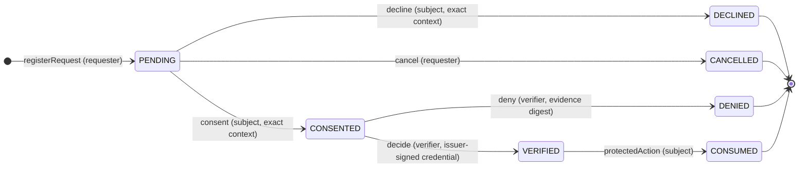

# MIG — Midnight Identity Gateway

MIG (Midnight Identity Gateway) is an experimental identity- and eligibility-verification
infrastructure project for the [Midnight Network](https://midnight.network/). Its product is a
single [Compact](https://docs.midnight.network/) smart contract — the **Verification Registry
(V3)** — that verifies a narrow, Compact-native, issuer-signed credential profile and gates a
**one-shot protected action** behind a consented, verifier-approved request.

The registry is an on-chain authorization state machine. A **requester** opens a verification
request, the **subject** consents to an exact purpose/policy context, a configured **verifier**
approves a credential that an authorized **issuer** has signed, and the subject may then perform
the protected action exactly once. Credential lifecycle (activation, revocation) is controlled by
a configured **status authority**.

> **Status: research / engineering prototype — local verification only.**
> Verification runs against an **ephemeral, testcontainers-managed local Midnight network**.
> This is **not** a production identity provider. It has **not** been deployed to Preprod or
> Mainnet, and it has **not** been independently audited.

---

## Contents

1. [Introduction and purpose](#1-introduction-and-purpose)
2. [Latest milestone: V3 local Stage C deployment and adversarial verification](#2-latest-milestone-v3-local-stage-c-deployment-and-adversarial-verification)
3. [The problem MIG solves and intended use cases](#3-the-problem-mig-solves-and-intended-use-cases)
4. [Verification Registry architecture and lifecycle](#4-verification-registry-architecture-and-lifecycle)
5. [Security model: signatures, consent, status, freshness, expiry, authorization, trust boundaries](#5-security-model-signatures-consent-status-freshness-expiry-authorization-trust-boundaries)
6. [Repository structure](#6-repository-structure)
7. [Security properties and adversarial test coverage](#7-security-properties-and-adversarial-test-coverage)
8. [Installation, compilation, testing, CI, and local Stage C](#8-installation-compilation-testing-ci-and-local-stage-c)
9. [Engineering challenges and lessons](#9-engineering-challenges-and-lessons)
10. [Known limitations and roadmap](#10-known-limitations-and-roadmap)
11. [Contributing, security reporting, and licensing](#11-contributing-security-reporting-and-licensing)

---

## 1. Introduction and purpose

MIG explores a single, well-scoped question: **how can one party prove to another that a
qualified third party vouched for a specific, narrowly-defined claim — without publishing the
underlying credential — and have that proof gate a consequential on-chain action?**

The answer implemented here is the **Verification Registry V3**, a Compact contract that:

- pins one authorized **issuer** and one **credential schema** at deployment time;
- binds an issuer signature to a specific **request, application, subject, claim, purpose and
  policy** so a signed credential cannot be reused in a different context;
- requires explicit **subject consent** before a verifier may evaluate a credential;
- checks **freshness, expiry, and revocation status** at decision time;
- consumes a successful decision **exactly once** for the subject's protected action.

MIG is deliberately narrow. A valid issuer signature proves only that the pinned issuer key
signed this profile's message, in this registry, for this request. It does **not** prove that the
issuer performed sound identity proofing, that the claim is true, or anything about a
person's real-world identity.

---

## 2. Latest milestone: V3 local Stage C deployment and adversarial verification

The current milestone establishes that Verification Registry V3 **compiles, builds, passes a
58-test contract suite, and executes end-to-end on a real (local, ephemeral) Midnight network**.

**Verified results (local only):**

| Check | Result |
| --- | --- |
| Compact compilation | Passed — 2 BBoard + 9 Registry circuits compiled |
| Contract typecheck / lint / build | Passed |
| Contract test suite (`vitest`) | **58 passed** (3 files) |
| CLI CI (typecheck / lint / build) | Passed |
| Stage C local deployment | Deployed and exercised V3 on an ephemeral local testkit network |

**Test breakdown — 58 total:**

| Suite | Tests | Scope |
| --- | ---: | --- |
| [`verification-registry.test.ts`](./contract/src/test/verification-registry.test.ts) | 24 | Registry V3 lifecycle, positive and boundary behavior |
| [`verification-registry-adversarial.test.ts`](./contract/src/test/verification-registry-adversarial.test.ts) | 21 | Adversarial/negative attack surfaces A–D |
| [`bboard.test.ts`](./contract/src/test/bboard.test.ts) | 13 | **Inherited** BBoard regression coverage (see below) |

> **Scope note on BBoard.** `contract/src/bboard.compact` is **inherited starter-scaffold code**
> from the Midnight bulletin-board example. It is **not** part of MIG's product architecture and
> is not presented here as a MIG contract or feature. It is retained (with its tests) because the
> build and CI compile it. Its 13 tests are reported only as **inherited regression coverage**;
> the BBoard UI (`bboard-ui/`) is likewise inherited scaffolding, not a MIG feature.

**Stage C deployment evidence is local-only.** The run used the local runner
[`bboard-cli/src/stage-c-registry-local.ts`](./bboard-cli/src/stage-c-registry-local.ts), which
starts a unique testcontainers Compose project (Midnight node + indexer), injects an existing
local proof server on port `6300`, deploys the **current V3 artifacts**, exercises the lifecycle
plus adversarial cases, reads final indexer state, and tears down only its own Compose project.
Successful operations finalized with `SucceedEntirely`; adversarial cases were **rejected before
submission** and therefore produced no on-chain transaction. Contract address, transaction IDs,
and block heights are **ephemeral run artifacts** with no explorer link. **No Preprod or Mainnet
service was contacted.**

---

## 3. The problem MIG solves and intended use cases

Multi-party verification of a single claim typically forces a bad trade-off: either the subject
discloses the whole credential, or a central server is trusted to hold and reveal it. MIG
demonstrates an on-chain alternative for a restricted class of claims:

- **Consent-gated.** A request cannot be evaluated until the subject consents to an exact
  context (application, claim, purpose, policy). Consent is a ledger state transition, not an
  off-chain agreement.
- **Context-bound.** The issuer's signature covers the request ID, application ID, subject key
  commitment, claim digest, purpose digest, and policy digest. A credential signed for one
  request is meaningless in another.
- **One-shot.** A verified request can authorize the protected action exactly once, and the
  action is re-checked against revocation and validity at execution time.
- **Revocable.** A configured status authority can revoke a credential, and revocation is
  enforced at both decision time and protected-action time.

**Intended use cases (illustrative):**

- Gate a privileged on-chain operation (mint, claim, redeem, role grant) behind proof that a
  designated issuer vouched for an eligibility claim.
- Record a consent-gated, verifier-approved eligibility decision as auditable on-chain state
  without publishing the credential.
- Prototype "verified eligibility, then act once" flows where the verifier, issuer, and status
  authority are distinct parties.

**Not intended for:** real-world identity verification, KYC/AML compliance decisions, W3C
Verifiable Credential interoperability, selective disclosure, or any setting that requires an
unlinkable, privacy-preserving presentation protocol.

---

## 4. Verification Registry architecture and lifecycle

The product contract is
[`contract/src/verification-registry.compact`](./contract/src/verification-registry.compact)
(`pragma language_version 0.23`). It composes the upstream credential core
`@midnight-ntwrk/credential-compact@0.3.0` and calls its `VC::assertAuthorizedIssuerProof` path
(canonical credential-body root, issuance-context Schnorr signature, issuer verification-method
reference, active issuer descriptor, issuer role, and schema scope).

### 4.1 On-chain state

| Ledger field | Type | Meaning |
| --- | --- | --- |
| `protocolVersion` | `VerificationProtocolVersion` | Pinned to `V3` at construction. |
| `verifier` | `Bytes<32>` | `identityKey` commitment of the approving verifier. |
| `issuerAuthorization` | `AuthorizedSignerDescriptor` | Active issuer descriptor (role + schema scope). |
| `credentialSchema` | `SchemaRef` | Pinned package/schema IDs and major/minor versions. |
| `statusAuthority` | `Bytes<32>` | `identityKey` commitment of the status authority. |
| `credentialStatuses` | `Map<Bytes<32>, CredentialStatus>` | Status keyed by `credentialStatusCommitment(handle)`. |
| `requests` | `Map<Bytes<32>, VerificationRequest>` | Requests keyed by `requestId`. |
| `protectedActionCount` | `Counter` | Total protected actions consumed. |

The constructor takes four arguments — `verifierKey`, `schema`, `issuer`, `statusAuthorityKey` —
and validates them (non-zero verifier/status authority, valid active issuer descriptor with issuer
role and a schema scope matching `issuerScopeCommitment(schema)`). These three authorities are
**immutable for the contract instance**.

### 4.2 Circuits (9)

`registerRequest`, `consent`, `decline`, `cancel`, `activateCredentialStatus`,
`revokeCredentialStatus`, `decide`, `deny`, `protectedAction`.

### 4.3 Request and credential lifecycle



`DECLINED`, `CANCELLED`, `DENIED`, and `CONSUMED` are **terminal**. Verification is one-shot:
approval moves a request to `VERIFIED`, and the subject's `protectedAction` moves it to
`CONSUMED` and increments `protectedActionCount`.

Credential status is a separate, monotonic machine:


`UNKNOWN → ACTIVE` can happen only once per handle, and `ACTIVE → REVOKED` is **irreversible**.
Status must be `ACTIVE` for `decide` to accept a credential, and it is re-checked by
`protectedAction`.

---

## 5. Security model: signatures, consent, status, freshness, expiry, authorization, trust boundaries

### Issuer-signature profile

The registry verifies a **Compact-native Jubjub Schnorr** signature over the canonical credential
body, in the issuance context defined by the upstream credential package. The signed
`RegistryClaims` binds `registryId`, `requestId`, `applicationId`, `subject`, `claimDigest`,
`purposeDigest`, and `policyDigest`. The credential envelope additionally binds the schema,
issuance (and optional expiration) timestamps, a holder-binding commitment, a status handle, the
claim root, and the credential version.

`decide` enforces, in order: caller is the verifier; request exists and is `CONSENTED`; every
claim field matches the stored request; `holderBinding == request.subject`; schema refs match;
the credential envelope is valid; the **issuer proof is authorized**; `issuerProof.challengeHash
== requestId`; and `issuerProof.createdAt == credential.issuedAt`.

### Consent

`consent` and `decline` require the caller to be the request's subject (`identityKey` of the
locally-held secret key must equal the stored subject commitment) and require the exact
application, claim, purpose, and policy digests. A requester can `cancel` only their own
`PENDING` request.

### Status and revocation

`activateCredentialStatus` and `revokeCredentialStatus` require the caller to be the configured
status authority. Handles must be non-zero. Activation is once-only; revocation is irreversible
and requires the handle to be `ACTIVE`. `decide` rejects unknown status (`Credential status is
unknown`) and non-active status (`Credential is revoked`). `protectedAction` **re-checks** that the
stored status handle is known and `ACTIVE`.

### Freshness and expiry (verifier-supplied time)

`decide` evaluates `assertCredentialTimeValid(issuedAt, maxCredentialAge, hasExpiration,
expiresAt)`:

- `issuedAt > 0` (rejects `Invalid credential issuance time`).
- block time is not before `issuedAt` (rejects `Credential issued in the future`).
- block time is not after `issuedAt + maxCredentialAge` (rejects `Credential is too old`).
- when `hasExpiration`, block time is not after `expiresAt` (rejects `Credential expired`).

The circuit returns `min(expiresAt, issuedAt + maxCredentialAge)` as the request's
`credentialValidUntil`, which `protectedAction` subsequently re-checks against block time
(rejects `Credential validity period ended`).

> **Disclosure — verifier-supplied time.** `issuedAt` and `expiresAt` come from the credential
> envelope that the configured verifier passes in; the freshness/expiry boundaries are enforced
> *relative to that assertion*. **A compromised or dishonest verifier can backdate or misreport
> credential time.** The contract does not consult an independent trusted clock for the credential
> timestamps.

### Authorization

Each state transition is gated by an `identityKey` commitment check: `registerRequest` records
the requester; `consent`/`decline`/`protectedAction` require the subject; `cancel` requires the
requester; `activate`/`revoke` status require the status authority; `decide`/`deny` require the
verifier. `identityKey(secretKey) = persistentHash([pad(32,"mig:auth-key:v3"), secretKey])`.

### Trust boundaries

- **The contract enforces the state machine and cryptographic bindings.** It does **not** prove
  that any authority is reputable. The deployment operator chooses `verifier`,
  `issuerAuthorization`, `schema`, and `statusAuthority`; the contract only enforces that they are
  well-formed and then consistent with themselves.
- **The issuer is trusted to have performed whatever proofing its signature implies.** The
  registry verifies the signature, not the underlying truth of the claim.
- **The verifier is configured and supplies credential time.** The verifier is a trust input for
  freshness/expiry.
- **The status authority is configured and authoritative over status.** It is a local
  contract-level status list, not a decentralized or externally-authenticated status registry.

---

## 6. Repository structure

An npm workspaces monorepo. The **MIG product surface** is the registry contract and its
supporting tooling; BBoard code is inherited scaffolding retained for build/CI.

```text
midnight-identity-gateway/
├── contract/                          # Compact sources + generated bindings
│   ├── src/
│   │   ├── verification-registry.compact        # ★ MIG product contract (V3)
│   │   ├── verification-registry-index.ts       # Compiled contract export (generated wrapper)
│   │   ├── verification-registry-witnesses.ts   # Witness: localSecretKey()
│   │   ├── bboard.compact                       # inherited scaffold (NOT a MIG contract)
│   │   ├── index.ts, witnesses.ts               # BBoard scaffold exports
│   │   └── test/
│   │       ├── verification-registry.test.ts             # 24 tests
│   │       ├── verification-registry-adversarial.test.ts # 21 tests
│   │       ├── verification-registry-simulator.ts        # circuit simulator
│   │       ├── verification-registry-credential-fixtures.ts # test credential signer
│   │       ├── bboard.test.ts                            # 13 inherited tests
│   │       └── bboard-simulator.ts, utils.ts
│   └── README.md                      # detailed contract-level documentation
├── bboard-cli/                        # CLI + local Stage C runner
│   └── src/
│       ├── stage-c-registry-local.ts            # ★ Stage C local deployment runner
│       ├── verification-registry-preprod.ts     # Preprod runner (not executed)
│       ├── config.ts                            # network + proof-server configuration
│       └── launcher/, index.ts, ...             # inherited BBoard CLI scaffolding
├── api/                               # shared types/utilities
├── bboard-ui/                         # inherited BBoard browser UI (not a MIG feature)
├── .github/workflows/ci.yaml, scan.yaml
├── package.json                       # workspaces: bboard-cli, bboard-ui, api, contract
└── LICENSE, SECURITY.md, CONTRIBUTING.md, CODE_OF_CONDUCT.md, SUPPORT.md, CHANGELOG.md
```

Generated bindings live under `contract/src/managed/` and are **gitignored** (they must be
regenerated by compiling the Compact sources). The Stage C runner consumes the current
`contract/src/managed/verification-registry` artifacts.

---

## 7. Security properties and adversarial test coverage

The suite runs generated Compact circuits through a simulator (not TypeScript mocks). The 21
adversarial tests are organized into four attack surfaces.

### Enforced properties

- **Caller authorization on every transition** — verifier, subject, requester, and status
  authority keys are checked by commitment at each circuit.
- **Context binding** — claim, request, application, subject, purpose, and policy must match the
  stored request; the holder binding must equal the subject.
- **Issuer proof integrity** — pinning to a specific issuer descriptor, schema scope, challenge
  hash (`== requestId`), and creation time (`== issuedAt`).
- **Time validity** — issuance time bounds, maximum age, and inclusive expiration, evaluated
  against block time; arithmetic fails closed on overflow of `Uint<64>`.
- **Status enforcement** — unknown and revoked statuses are rejected at both `decide` and
  `protectedAction`.
- **Terminal-state protection** — `DECLINED`, `CANCELLED`, `DENIED`, `CONSUMED` cannot be
  exited; re-registering an existing `requestId` is rejected; repeated `decide` on a `VERIFIED`
  request and repeated `protectedAction` on a `CONSUMED` request are rejected.
- **One-shot authorization** — `protectedActionCount` increments only on a successful
  `protectedAction`.
- **Ledger-state privacy boundary** — the request record stores only commitments (claim roots,
  hashed status handle, evidence digest), not raw claims, signatures, or unhashed handles.

### Adversarial coverage map

| Surface | Examples of what the tests assert |
| --- | --- |
| **A. Time and validity** | Malformed issuance time (`issuedAt = 0`); not-yet-valid; expired at block time; expiry crossing between verification and execution; `maxCredentialAge` exceeded after verification; `Uint<64>` overflow fails closed. |
| **B. Revocation & state transitions** | Revoke after consent before approval; revoke after approval before action; unauthorized revocation/activation; zero status handle; repeated revocation and re-activation of a revoked handle; terminal-state bypass by re-registering; invalid transitions from terminal states. |
| **C. Signature & context binding** | Mismatched challenge hash; mismatched `createdAt`; single-field alteration of every security-relevant field; signature reuse across different requests. |
| **D. Replay, authorization & privacy** | Cross-contract credential replay; repeated finalization; repeated protected action; strict caller authorization for all transitions; verification that raw claims/signatures/unhashed handles are absent from contract state. |

These tests establish circuit-level enforcement. They do **not** constitute an independent audit,
and they do not prove properties outside the contract (e.g., proof infrastructure leaks).

---

## 8. Installation, compilation, testing, CI, and local Stage C

### Prerequisites

- **Node.js >= 24.11.1** (`.nvmrc` pins `24.11.1`; CI uses Node 24).
- **Docker** — for the local Midnight node/indexer (testcontainers) and the proof server.
- **Compact compiler `0.31.1`** available as `compact` on `PATH`.
- Proof server image `midnightntwrk/proof-server:8.0.3` for local work
  (`8.1.3` is the Preprod image).

### Install

```bash
npm install
```

### Compile the Compact contracts

Generated `managed/` artifacts are not committed and must be produced before building the CLI:

```bash
npm run compact --prefix contract
npm run build   --prefix contract
```

### Test

```bash
npm test --prefix contract -- --run      # 58 tests
```

> Note: `vitest` prints "Sourcemap … points to missing source files" for the generated
> `bboard`/`verification-registry` JS. The only genuinely absent path is the compiler-embedded
> `compiler/standard-library.compact`. This is a **harmless, intentional compiler artifact**;
> tests pass and no generated file is edited to silence it.

### CI

Contract CI (compact → typecheck → lint → build → test):

```bash
npm run ci --prefix contract
```

CLI CI (typecheck → lint → build):

```bash
npm run ci --prefix bboard-cli
```

The GitHub workflow [`.github/workflows/ci.yaml`](./.github/workflows/ci.yaml) runs these
workspace CI scripts (contract, api, bboard-cli, bboard-ui) on Node 24 with the Compact `0.31.1`
setup action.

### Local Stage C (ephemeral local network)

Stage C deploys the **current V3 artifacts** to an ephemeral testcontainers local network and
exercises the full lifecycle plus adversarial negative cases. It requires the compiled artifacts
above and a running local proof server.

```bash
# 1. Start the local proof server (http://127.0.0.1:6300)
docker compose -f bboard-cli/proof-server-local.yml up -d

# 2. Run Stage C (starts an ephemeral node + indexer, then tears down only its own project)
cd bboard-cli
node --experimental-specifier-resolution=node --loader ts-node/esm src/stage-c-registry-local.ts
```

The runner injects the **existing** proof server on port `6300` (it does not start a second one),
sets network id `undeployed`, and in its `finally` block shuts down the environment / tears down
only the compose project it created. It never targets Preprod.

**Behaviors exercised against a real local chain** — successful operations finalized with
`SucceedEntirely`:

- `registerRequest` (main, pending, cancellation, denial, revocation, revoked-after-approval)
- `activateCredentialStatus` (main + revocation handles)
- `consent` / `decline` / `cancel` / `deny`
- valid issuer-signed `decide` → `VERIFIED`, then subject `protectedAction` → `CONSUMED`
  (`protectedActionCount` becomes `1`)
- `decide` then `revokeCredentialStatus` after approval → `protectedAction` rejected

**Adversarial cases rejected before submission** (no on-chain transaction):

- unauthorized verifier decision (`Not the verifier`)
- expired credential (`Credential expired`) and not-yet-valid credential
  (`Credential issued in the future`)
- tampered issuer signature (`Signature verification failed`) and altered signed claim
  (`Credential claim digest mismatch`)
- mismatched proof challenge (`Proof challenge hash mismatch`)
- protected action while pending / after decline / after denial / repeated
  (`Request is not verified`)
- unauthorized revocation (`Not the status authority`), zero-handle revocation
  (`Invalid status handle`)
- decision with revoked credential (`Credential is revoked`)
- protected action after post-approval revocation (`Credential is revoked`)

Example invocation and artifact paths are also documented in
[`contract/README.md`](./contract/README.md).

---

## 9. Engineering challenges and lessons

- **Compact-native issuer signatures are exact.** The registry pins the upstream credential core
  `@midnight-ntwr/credential-compact@0.3.0` and composes its `credentials/composable.compact`
  root. Its README version guidance is stale relative to its published manifest. Compact's
  include resolver does not accept a bare npm package name; the source includes the installed
  package's `dist` composition root via a workspace-relative `node_modules` path.
- **Time is a trust input, not a fact.** Because the pinned toolchain exposes no trusted wall
  clock to the contract, freshness/expiry can only be enforced relative to the verifier's
  assertion. Making this explicit (and testing it) was necessary to avoid overclaiming.
- **Status is local, monotonic state.** Designing activation (once) and revocation (irreversible,
  `ACTIVE`-only) as a separate machine, and re-checking status at `protectedAction`, closes the
  "revoked after approval" gap.
- **One-shot semantics needed a counter plus terminal states.** Verifying exactly-once
  authorization required both a monotonic `protectedActionCount` and strict terminal-state
  enforcement, including rejection of duplicate `requestId` registration.
- **Artifact consistency matters.** Managed bindings must remain byte-identical between
  `contract/src/managed`, `contract/dist/managed`, and the CLI-distributed copies; the Stage C
  runner must deploy current V3 artifacts, not stale bindings.
- **Proving infrastructure can dominate runtime.** The HTTP proof provider uses a 300 s timeout;
  a cold proof server that is still downloading the `bls_midnight_2p17` ZK parameters can exceed
  it. Caching ZK parameters locally and mounting them into the proof server removed
  network-bound timeouts. This is an environment concern, not a contract change.
- **Sourcemap warnings were investigated, not silenced.** Only the compiler-embedded
  `compiler/standard-library.compact` path is genuinely absent; no generated file was edited.

---

## 10. Known limitations and roadmap

**Known limitations (explicit, by design of this prototype):**

- **Local-only, not production-ready.** Verified only against an ephemeral local testkit
  network. No Preprod or Mainnet deployment has been performed. Not independently audited.
- **Verifier-supplied credential time.** Freshness/expiry are enforced relative to the configured
  verifier's assertion; a dishonest verifier can backdate or misreport time.
- **Configured authorities are trust inputs.** The verifier, issuer, and status authority are
  chosen by the deployment operator; the contract does not prove any of them is reputable.
- **Post-approval revocation is checked at decision and protected-action time**, but **expiry is
  not re-evaluated at the later protected-action call** (only `credentialValidUntil`, captured at
  decision, is re-checked). This is a deliberate boundary, not continuous freshness enforcement.
- **Status list is contract-local**, not a decentralized or externally-authenticated registry.
- **Correlation and linkage risk.** Public state includes the verifier commitment, issuer
  descriptor/public key, schema, status-authority commitment, request ID, subject commitment,
  application/claim/purpose/policy digests, maximum age, request state, credential-body root,
  status-handle commitment, status state, and the protected-action counter. These fields and
  transaction metadata may be linkable, and low-entropy hashes can be guessed.
- **Narrow signature profile.** A valid signature proves only that the pinned issuer key signed
  this profile's message. It does not prove the claim is true.
- **Not W3C VC/VP.** No W3C Verifiable Credential/Presentation interoperability is implemented or
  claimed.
- **No selective disclosure or unlinkability.** The project does not implement selective
  disclosure or unlinkability and makes no such claims. The ledger-state privacy test verifies
  that raw claims/signatures/unhashed handles are absent from contract state; it is not a proof
  that transaction inputs, network metadata, or proving infrastructure cannot leak values.
- **Preprod path not executed.** `npm run preprod-registry --prefix bboard-cli` has not been run
  (no Blockfrost token or funded wallet configured).

**Roadmap (candidate directions, not commitments):**

- Broaden the credential profile beyond a single pinned issuer/schema.
- Explore externally-authenticated or decentralized status sources.
- Explore trusted time sources for `issuedAt`/`expiresAt` to reduce reliance on the verifier.
- Expand adversarial and property-based testing; commission an independent audit.

---

## 11. Contributing, security reporting, and licensing

### Contributing

Contributions follow the Midnight Foundation process described in
[CONTRIBUTING.md](./CONTRIBUTING.md) and the [CODE_OF_CONDUCT.md](./CODE_OF_CONDUCT.md). In
summary: fork, branch, follow the existing code style, include tests for new or changed
behavior, and submit a pull request. New functionality should include corresponding tests and
documentation updates.

### Security reporting

Please report suspected vulnerabilities using **GitHub private vulnerability reporting**, not
public issues, as described in [SECURITY.md](./SECURITY.md). Do not include secrets, seeds,
private keys, or real identity/credential data in reports or in the repository. The repository
excludes `.env*`, `project.md`, generated `managed/`, `dist/`, logs, local databases, and ZK
proving keys/parameters. Support and community channels are listed in [SUPPORT.md](./SUPPORT.md).

### Licensing

The repository ships an **Apache License 2.0** text in [LICENSE](./LICENSE), and source files
carry Apache-2.0 SPDX headers. Note: the workspace [`package.json`](./package.json) declares
`"license": "MIT"`, which conflicts with the `LICENSE` file; this discrepancy should be
reconciled by the maintainers.
